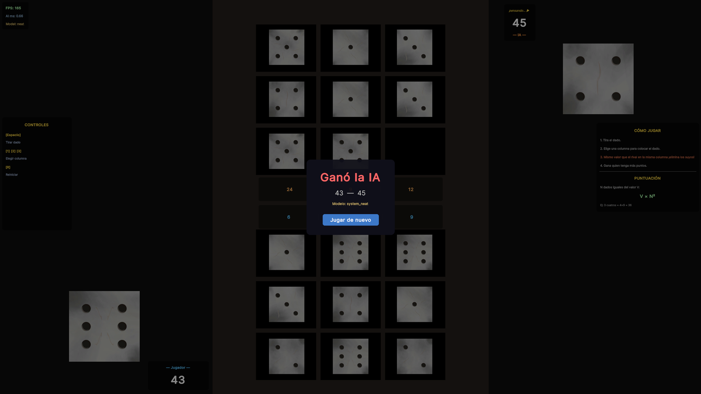
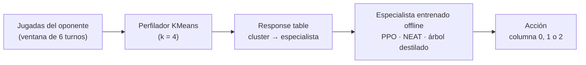

# Knucklebones AI Gym

**¿Puede una IA aprender de un jugador mientras juega, en un computador doméstico?**

Con PPO, NEAT y árboles de decisión destilados, no: una sesión de juego no da datos suficientes. Este repositorio mide cuántos faltan y construye una alternativa que sí corre en CPU: perfilar al oponente y elegir entre especialistas ya entrenados.



Tesis de Ingeniería de Ejecución en Computación e Informática, Universidad del Bío-Bío, 2026: *Rendimiento y desempeño del aprendizaje de distintas inteligencias artificiales en un entorno de videojuego offline*. El juego es **Knucklebones**, el minijuego de dados de *Cult of the Lamb*.

## En tres números

| Número | Qué mide |
|:------:|----------|
| **222×** | Lo que le falta a una sesión de juego larga (1,800 muestras) para llegar a las 400,000 con que se entrenó PPO |
| **< 33 min** | Entrenamiento de cada especialista, sin GPU |
| **< 1 ms** | Decisión por turno del sistema completo en CPU (media de 0.2 a 0.5 ms) |

## 1. El problema: la brecha de datos

Una partida dura unos 18 turnos. Un jugador que juega entre 10 y 100 partidas genera entre 180 y 1,800 muestras. Los tres paradigmas se entrenaron con dos a cuatro órdenes de magnitud más:

| Paradigma | Datos de entrenamiento | Datos en una sesión | Brecha |
|-----------|-----------------------:|--------------------:|-------:|
| PPO (400k timesteps) | ~400,000 muestras | 180 a 1,800 | 222× a 2,222× |
| DT (behavior cloning) | ~500,000 muestras | 180 a 1,800 | 278× a 2,778× |
| NEAT (300 gen × 150 pop) | ~4,590,000 episodios | 180 a 1,800 | 2,550× a 25,500× |

Más cómputo no cierra la brecha: el límite es cuántas partidas está dispuesta a jugar una persona.

> Las muestras por sesión son una estimación, no una medición con jugadores. Los datos de entrenamiento son el presupuesto que se usó, no un mínimo medido.

## 2. La alternativa: adaptación por selección

Durante la partida no se entrena nada. El sistema observa al oponente, lo clasifica y le asigna el especialista que mejor responde a ese estilo.



Los especialistas se entrenan antes, contra cuatro arquetipos heurísticos (greedy, denial, spread, random):

| Paradigma | Entrenamiento por especialista | Tamaño del modelo |
|-----------|-------------------------------:|------------------:|
| PPO | 6 a 23 min | 162 KB |
| NEAT (multi-seed, 300 generaciones) | 30 a 33 min | 2.4 a 4.2 KB |
| DT destilado desde PPO | < 3 s | 134 a 153 KB |

El árbol destilado conserva más del 93% de fidelidad a su teacher PPO.

## 3. Resultados

Cada sistema jugó 5,000 partidas contra cada uno de tres oponentes heurísticos.

| Sistema | Winrate | IC 95% | Significancia |
|---------|:-------:|:------:|:-------------:|
| **System NEAT** | **0.653** | [0.645, 0.660] | Superior (p < 0.003) |
| System DT | 0.608 | [0.600, 0.616] | Equivalente a PPO |
| System PPO | 0.604 | [0.597, 0.612] | Equivalente a DT |

### ¿Aporta la selección?

| Familia | Mejor especialista fijo | Sistema adaptativo | Oráculo (selección perfecta) |
|---------|:-----------------------:|:------------------:|:----------------------------:|
| DT | 0.618 | 0.608 | 0.619 |
| PPO | 0.610 | 0.604 | 0.617 |
| NEAT | 0.651 | 0.653 | 0.651 |

El sistema adaptativo iguala al mejor especialista fijo y no lo supera (diferencias de −0.010 a +0.002). El oráculo muestra por qué: ni la selección perfecta sumaría más de 0.008, porque un solo especialista ya rinde bien contra todos los estilos. Knucklebones tiene poca diversidad estratégica; en dominios con más, se esperaría un beneficio mayor.

### Latencia

Decisión completa por turno (perfilado, selección e inferencia), medida en los `turns.jsonl` de las corridas publicadas:

| Sistema | Media | p95 | p99 |
|---------|------:|----:|----:|
| System DT | 0.22 ms | 0.43 ms | 0.57 ms |
| System PPO | 0.46 ms | 0.81 ms | 1.02 ms |

### Limitaciones

- Los oponentes de entrenamiento y evaluación son heurísticos, no jugadores humanos.
- El perfilador asigna 2 de 4 clusters al estilo denial (silhouette 0.232): no separa bien todos los estilos.
- Los resultados valen para los paradigmas evaluados. Meta-RL y aprendizaje en contexto apuntan a esta misma brecha y quedan como trabajo futuro.

Detalle completo en [`docs/03_resultados_experimentales.md`](docs/03_resultados_experimentales.md) y en [`gym/data/results/reports/`](gym/data/results/reports/).

## Ejecución rápida

```bash
pip install -r requirements.txt

# Validar el entorno
python -m gym.scripts.utils.test_env_sanity

# 5,000 partidas: sistema adaptativo con árboles contra el heurístico denial
python -m gym.scripts.utils.evaluate_any --p0 "system:gym/config/systems/system_dt.json" --p1 "heuristic:denial" --games 5000
```

<details>
<summary><strong>Pipeline completo de entrenamiento</strong> (click para expandir)</summary>

```
Arquetipos heurísticos (greedy/denial/spread/random)
        ↓ entrenar contra cada uno
PPO especialistas (PPO vs denial, vs spread, vs greedy)
        ↓ behavior cloning
DT destilados (dt__ppo_vs_denial, dt__ppo_vs_spread, dt__ppo_vs_greedy)
        ↓ perfilar oponentes
KMeans v2 (clustering de estilos online)
        ↓ evaluar mejor respuesta por cluster
Response Table (cluster → mejor DT)
        ↓ orquestar
SystemPolicy = KMeans + DT especialistas = adaptación online sin entrenamiento
```

```bash
# 1. Validar entorno
python -m gym.scripts.utils.test_env_sanity

# 2. Entrenar PPO especialista
python -m gym.scripts.rl.train_sb3 --algo PPO --timesteps 400000 --opponent heuristic:denial

# 2b. Entrenar NEAT especialista
python -m gym.scripts.neat.train_neat --opponent heuristic:denial --generations 50

# 3. Generar dataset BC (destilación)
python -m gym.scripts.decision_tree.generate_dataset_teacher --teacher rl:PPO:gym/data/models/rl/PPO__vs_denial.zip --opponent heuristic:denial --episodes 50000

# 4. Entrenar DT destilado
python -m gym.scripts.decision_tree.train_tree --dataset gym/data/datasets/raw/<carpeta>

# 5. Entrenar KMeans
python -m gym.scripts.kmeans.train_kmeans --opponents heuristic:denial heuristic:spread heuristic:greedy heuristic:random

# 6. Construir response table
python -m gym.scripts.kmeans.build_response_table --kmeans gym/data/models/kmeans/kmeans__v2__archetypes.joblib --candidates dt:gym/data/models/sklearn/dt__ppo_vs_denial.joblib dt:gym/data/models/sklearn/dt__ppo_vs_spread.joblib dt:gym/data/models/sklearn/dt__ppo_vs_greedy.joblib --games-per-cluster 3000 --swap-roles --out gym/data/models/systems/response_table__system_dt.json

# 7. Evaluar sistema
python -m gym.scripts.utils.evaluate_any --p0 "system:gym/config/systems/system_dt.json" --p1 "heuristic:denial" --games 5000

# 8. Generar gráficos y tablas
python -m gym.scripts.utils.analysis_toolkit

# 9. Validar artefactos
python -m gym.scripts.utils.artifacts_doctor --fix
```

</details>

## Reglas del código

| Regla | Aplica en | ✅ Puede | ❌ No puede |
|-------|-----------|----------|-------------|
| **A** | `policies/` | Inferir acciones, estado por partida | Entrenar, escribir archivos |
| **B** | `scripts/` | Entrenar, evaluar, generar datos | Duplicar lógica de features/heurísticas |
| **C** | `data/` | Almacenar todo lo generado | Contener código |

## Documentación

| Documento | Contenido |
|-----------|-----------|
| `docs/01_marco_teorico.md` | Problema, hipótesis, antecedentes, técnicas, glosario |
| `docs/02_arquitectura_pipeline.md` | Pipeline, estructura, reglas, features |
| `docs/03_resultados_experimentales.md` | Hallazgos, tabla de runs, interpretaciones |
| `docs/04_referencia_scripts.md` | Referencia de cada script: parámetros, salidas, métricas |
| `docs/05_handoff_unity.md` | Especificación técnica para integración con Unity |
| `docs/06_trabajo_relacionado.md` | Posicionamiento frente a la literatura y al trabajo previo sobre el juego |

Hecho con Python, Stable-Baselines3, PyTorch, neat-python y scikit-learn.

<details>
<summary><strong>Mecánica de turnos y reproducibilidad</strong> (click para expandir)</summary>

Reglas completas en `docs/05_handoff_unity.md` (§2). Resumen para poder replicar el experimento:

1. El jugador activo **tira un dado** (1-6).
2. Elige una **columna** (0, 1 o 2) con al menos una fila vacía.
3. El dado se coloca en la primera fila vacía de esa columna (de abajo hacia arriba).
4. **Regla de destrucción**: todos los dados del oponente con el mismo valor en la misma columna se eliminan.
5. Se recalculan puntajes: `Score(columna) = Σ v × (cantidad de v en la columna)²`.
6. La partida termina cuando algún jugador completa su tablero (9 celdas); gana el mayor puntaje total.

`KnucklebonesEnv` (`gym/env/knucklebones_env.py`) es la única fuente de verdad de estas reglas: todo entrenamiento/evaluación sigue el mismo protocolo (`roll_die → _get_obs → select_action → step`).

**Registro turno a turno**: cada corrida de `evaluate_any.py` genera, en `gym/data/results/runs/<stamp>/`:

| Archivo | Contenido |
|---------|-----------|
| `config.json` | Configuración de la corrida |
| `turns.jsonl` | Registro turno a turno (incluye `latency_ms`), el log grande que permite auditar cada decisión |
| `games.jsonl` | Registro partida a partida |
| `summary.json` | Resumen con todas las métricas |

**Reproducibilidad**: todas las corridas usan `--seed` para fijar reset del entorno, reset de políticas y generación de episodios, de modo que las comparaciones entre sistemas sean justas y el experimento sea replicable con los mismos artefactos (`*.meta.json`) documentados en `docs/04_referencia_scripts.md`.

</details>

<details>
<summary><strong>Estructura del proyecto</strong> (click para expandir)</summary>

```
gym/
├── config/
│   ├── neat/neat_config.ini              # Config NEAT (solo inferencia comparativa)
│   └── systems/                          # Configs JSON de sistemas
│       ├── system_dt.json
│       ├── system_ppo.json
│       └── system_neat.json
├── data/
│   ├── datasets/raw/                     # Datasets de behavior cloning
│   ├── models/
│   │   ├── kmeans/                       # KMeans + response tables
│   │   ├── neat/                         # Genomas NEAT (.pkl)
│   │   ├── rl/                           # PPO especialistas (.zip + .meta.json)
│   │   ├── sklearn/                      # DT destilados (.joblib + .meta.json)
│   │   └── systems/                      # Response tables por sistema
│   └── results/runs/                     # Corridas auto-generadas
├── env/
│   ├── knucklebones_env.py               # Entorno (fuente de verdad de reglas)
│   └── knucklebones_sb3_env.py           # Wrapper Gymnasium para SB3
├── policies/                             # Solo inferencia (Regla A)
│   ├── archetypes/                       # greedy, denial, spread, random
│   ├── decision_tree/                    # baseline + sklearn DT
│   ├── kmeans/                           # KMeans adapter (perfilado + selección)
│   ├── neat/                             # NEAT (solo inferencia comparativa)
│   ├── rl/                               # SB3 wrapper (PPO/DQN)
│   ├── systems/                          # SystemPolicy (KMeans + especialistas)
│   └── utils/
│       ├── base_policy.py                # Contrato abstracto
│       ├── features.py                   # extract_features(), 21 dims
│       └── policy_factory.py             # build_policy(spec), fábrica única
└── scripts/                              # Entrenamiento y evaluación (Regla B)
    ├── decision_tree/
    │   ├── generate_dataset_teacher.py   # BC dataset desde cualquier teacher
    │   └── train_tree.py                 # Entrenar DT sklearn
    ├── kmeans/
    │   ├── train_kmeans.py               # Entrenar KMeans con arquetipos
    │   └── build_response_table.py       # Response table por estilo
    ├── neat/
    │   └── train_neat.py                 # Entrenar NEAT especialista
    ├── rl/
    │   └── train_sb3.py                  # Entrenar PPO/DQN
    └── utils/
        ├── evaluate_any.py               # Evaluación universal p0 vs p1
        ├── run_manager.py                # Gestión de runs (Regla C)
        ├── naming.py                     # utc_stamp(), safe_name()
        ├── artifacts_doctor.py           # Validar/reparar artefactos
        └── test_env_sanity.py            # Test de sanidad del entorno
```

</details>

<details>
<summary><strong>Policy specs</strong> (fábrica única, click para expandir)</summary>

```
baseline:first | baseline:random
heuristic:greedy | heuristic:denial | heuristic:spread | heuristic:random
dt:<path.joblib>
rl:PPO:<path.zip>
neat:<genome.pkl>:<config.ini>
system:<config.json>
```

</details>
